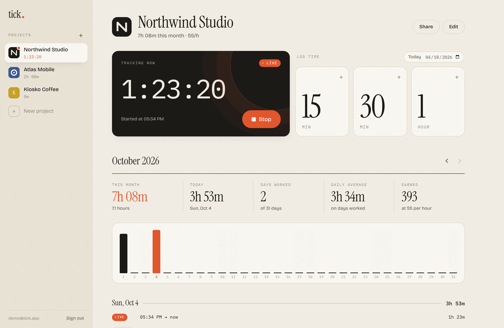
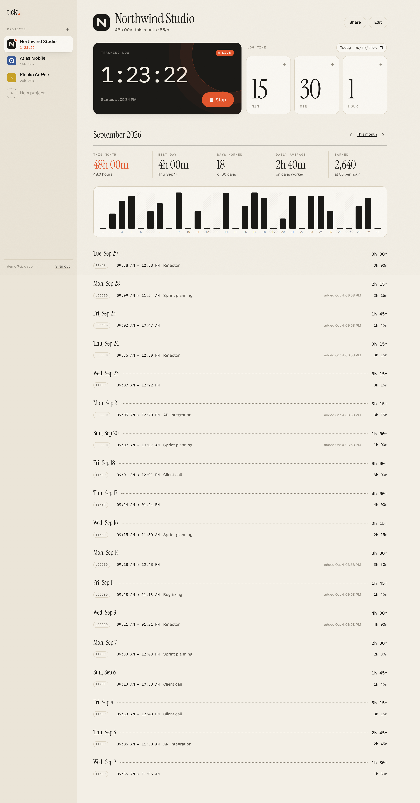
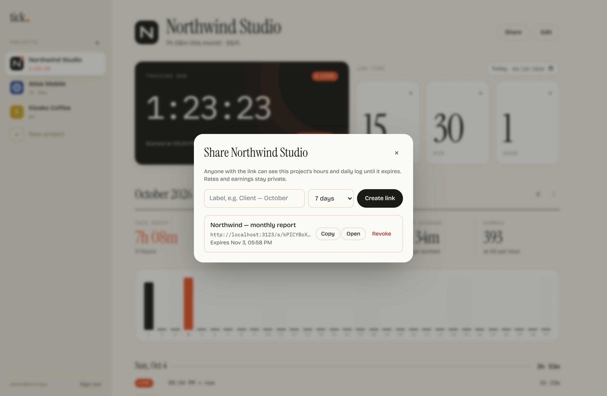
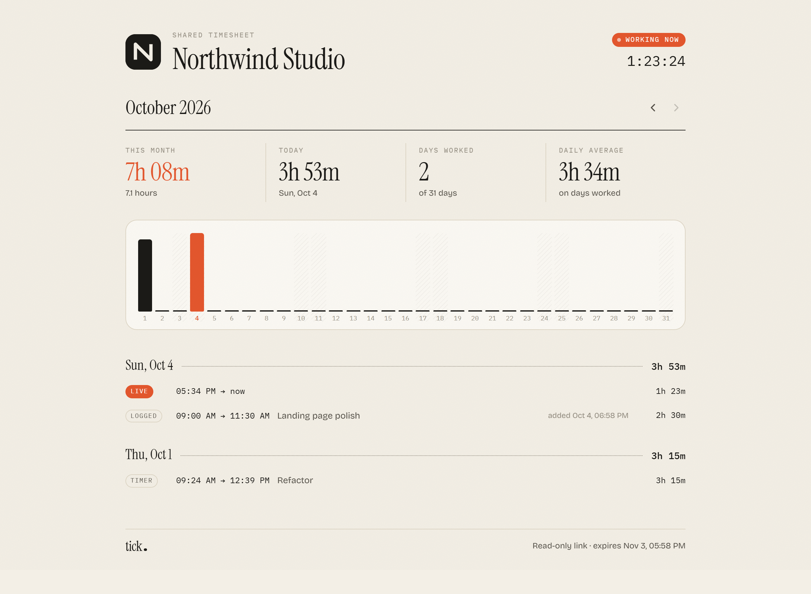
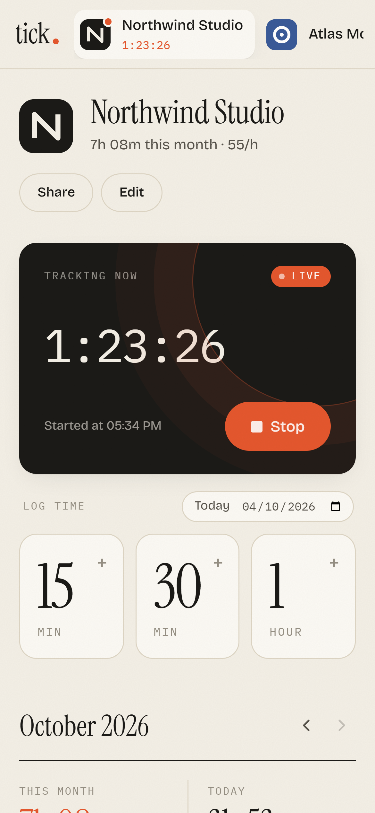
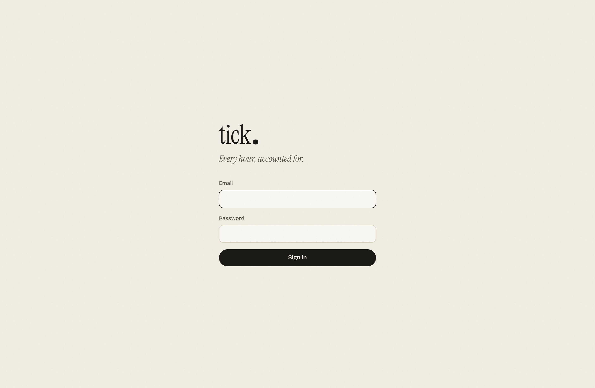

# tick.

A small, self-hosted time tracker for freelancers. Start a timer when you sit down to work, or log time with one tap on big **+15 min / +30 min / +1 hour** cards. See your month at a glance and share a read-only timesheet with a client through a link that expires.



## Features

- **Projects** with a name, logo image and color, listed in a sidebar (a tab strip on mobile).
- **Live timer.** One timer runs at a time; starting another project stops the current one. The running clock shows in the sidebar from any page.
- **Quick log cards.** +15m, +30m and +1h, for today or any past day.
- **Monthly view.** Month total, today (or best day), days worked, daily average and earnings when you set an hourly rate. Includes a per-day bar chart and the full log grouped by day.
- **Editable log.** Click any entry to change its day, times or note, or to delete it. Quick adds can be undone from the toast.
- **Share links.** Read-only links for a single project that expire after 24h, 7, 30 or 90 days. You can revoke them at any time. Rates and earnings are never shared.
- **Single-user auth.** One email and password, set through environment variables.

| Past month                                | Share a timesheet                               |
| ----------------------------------------- | ----------------------------------------------- |
|  |  |

| What your client sees                           | Mobile                                  | Login                                 |
| ----------------------------------------------- | --------------------------------------- | ------------------------------------- |
|  |  |  |

## How it works

```
Browser (React SPA)  ──/api──▶  Node 22 + Hono  ──▶  SQLite (node:sqlite) in /data/tick.db
```

- **One container, one file.** The Node server serves the built SPA and the JSON API. All data lives in a single SQLite file, and project images are stored inline as small WebP data URLs. There are no native dependencies, because the server uses Node's built-in `node:sqlite` and runs TypeScript through Node's type stripping.
- **Entries** have a `startedAt` and an `endedAt`. A running timer has `endedAt = null`, and a unique index guarantees there is only ever one. Each entry records whether it came from the timer or a manual log, and when it was added. The log shows this as "added Oct 4, 18:57".
- **Day grouping** uses the browser's timezone, so totals match your local calendar. An entry belongs to the day it started on.
- **Auth.** `POST /api/login` checks the credentials with constant-time comparison and sets an HMAC-signed, `HttpOnly`, `SameSite=Lax` cookie that lasts 30 days. Failed logins are rate-limited per IP.
- **Share links** are random 144-bit tokens. `/s/<token>` renders a read-only page that only reaches `GET /api/public/:token`. That endpoint returns the project's name, logo and entries, and nothing else. Expired links stop working right away and are pruned every hour.

## Configuration

| Variable        | Required | Default                   | Description                                                                                 |
| --------------- | -------- | ------------------------- | ------------------------------------------------------------------------------------------- |
| `TICK_EMAIL`    | yes      | `admin@tick.local` in dev | Email you log in with.                                                                      |
| `TICK_PASSWORD` | yes      | `tick` in dev             | Password you log in with. Use something long.                                               |
| `TICK_SECRET`   | no       | derived from credentials  | Key that signs session cookies. If you change the email or password, you are signed out everywhere. |
| `PORT`          | no       | `3000`                    | HTTP port.                                                                                  |
| `DATA_DIR`      | no       | `./data` (`/data` in Docker) | Folder that holds the SQLite database.                                                   |

In production (`NODE_ENV=production`, which the Docker image sets), the server refuses to start without `TICK_EMAIL` and `TICK_PASSWORD`.

## Deploy on Coolify (tick.jonathanfernandezfm.com)

1. **DNS.** Add an `A` record `tick.jonathanfernandezfm.com` that points to your VPS IP.
2. **Create the resource.** In Coolify, go to **Projects → your project → + New → Public Repository** and paste:
   ```
   https://github.com/jonathanfernandezfm/tick
   ```
   Branch `main`. For **Build Pack**, pick **Docker Compose**. Coolify reads `docker-compose.yml`, which already defines the persistent volume and the health check.
3. **Domain.** On the `tick` service, set **Domains** to `https://tick.jonathanfernandezfm.com`. Coolify routes it to port 3000 and issues the TLS certificate.
4. **Environment variables.** Fill in `TICK_EMAIL` and `TICK_PASSWORD`. `TICK_SECRET` is optional.
5. Click **Deploy**. Open `https://tick.jonathanfernandezfm.com` and sign in.

Your data lives in the `tick-data` volume, so it survives redeploys. To back it up, copy `/data/tick.db` out of the volume.

> **Prefer the Dockerfile build pack?** That also works. Choose **Dockerfile**, set the port to `3000`, add the same env vars and add a persistent storage mount at `/data`.

### Any other Docker host

```bash
docker compose up -d --build   # needs TICK_EMAIL and TICK_PASSWORD in the environment or a .env file
```

## Local development

Requires Node **22.18+**.

```bash
npm install
npm run dev          # API on :3000, Vite on :5173 → open http://localhost:5173
                     # login: admin@tick.local / tick
```

| Script                | What it does                                                                |
| --------------------- | --------------------------------------------------------------------------- |
| `npm run dev`         | API with `--watch` plus the Vite dev server with an `/api` proxy.           |
| `npm run build`       | Type-checks everything and builds the SPA into `dist/`.                     |
| `npm start`           | Runs the production server. It serves `dist/` when that folder exists.      |
| `npm run seed`        | Creates demo data in `./data-demo`.                                         |
| `npm run screenshots` | Seeds demo data, starts the build and regenerates `docs/screenshots/`. Needs local Chrome, or set `CHROME_PATH`. |

## Project layout

```
server/
  index.ts     routes, validation, static hosting
  db.ts        schema + queries (node:sqlite)
  auth.ts      credentials, signed session cookie, login rate limit
  config.ts    environment
src/
  components/  Dashboard, Sidebar, ProjectView, Stats (KPIs, chart, log), dialogs, SharePage
  lib/         time math and formatting, hooks, image resizing
scripts/       demo seed + screenshot automation
```

## License

MIT
